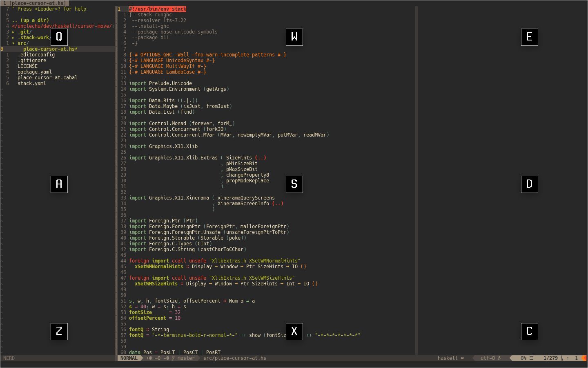

A utility for X11 that moves the mouse cursor using the keyboard.
Written in Haskell.

This utility lets you quickly move the mouse cursor to one of 9 common spots on
the screen. It is intended to reduce mouse usage, but not to replace the mouse
completely. It does not provide precise aiming; it only provides approximate
positioning.

Bind a hotkey in your WM configuration, or by using [xbindkeys], to run
`place-cursor-at` — for example, `Super+M`. When you press the hotkey, 9 windows
appear on the current screen, each showing a letter. Press the corresponding
letter on your keyboard, and the mouse cursor will move to the center of that
window; the application then exits. This lets you quickly move the mouse cursor
to one of 9 different spots with a two-step key combo.

Other key bindings:

1. Press `Escape` to close the application
   when one of the *letter* windows is focused.

2. Move focus to the *letter* window where you want the mouse cursor to be,
   then press `Enter`. This is the same as pressing that window’s letter on
   your keyboard.

I originally created this tool for myself, to use with
[xmonad](https://github.com/unclechu/xmonadrc)
and [i3](https://github.com/unclechu/i3rc).



## Requirements

Either one:

1. [Nix Package Manager]

2. [The Haskell Tool Stack] and:

   1. `libX11` development files
   2. `libXinerama` development files

## How to use

### With Nix

See [Nix Package Manager].

It is available in [nixpkgs], so you can just run it right away:

``` sh
nix-shell -p place-cursor-at --run place-cursor-at
```

Or:

``` sh
nix run nixpkgs#place-cursor-at
```

### NixOS

You can add this application to your NixOS `configuration.nix`:

``` nix
{ pkgs, ... }:
{
  environment.systemPackages = [ pkgs.place-cursor-at ];
}
```

Or pick any Git commit (e.g. latest version from the `master` branch)
and build it from sources:

``` nix
{ pkgs, lib, ... }:
let
  place-cursor-at-src = pkgs.fetchFromGitHub {
    owner = "unclechu";
    repo = "place-cursor-at";
    # Git commit hash.
    rev = "ffffffffffffffffffffffffffffffffffffffff";
    # Will be calculated and shown the build failure log.
    # Just put that value from the log here.
    hash = lib.fakeHash;
  };

  place-cursor-at = pkgs.callPackage place-cursor-at-src {};
in
{
  environment.systemPackages = [ place-cursor-at ];
}
```

### With Stack

See [The Haskell Tool Stack].

``` sh
stack build
stack exec place-cursor-at
```

You can install `place-cursor-at` binary to `~/.local/bin` directory
(make sure you have this directory in your `PATH` environment variable):

``` sh
stack install
```

## Running it as script

Assuming that you have the GHC with all the required dependencies available in
your `PATH` (e.g. by entering `nix-shell`) you can just run it like this:

``` sh
runhaskell src/place-cursor-at.hs
```

But it starts faster and works more responsive when you pre-compile it.
Though running it as a script is still pretty usable.

You can also try to run it as a `nix-shell` script (it has `nix-shell` shebang
with a [nixpkgs] pin, so it’s reproducible) as a proof-of-concept.
But it takes a bit of time to start. Not for every day use:

``` sh
src/place-cursor-at.hs
```

## Usage info

<!-- Usage info starts -->

TODO: Put generated usage info here from the `place-cursor-at help` call.

<!-- Usage info ends -->

## Development/contribution notes

### Using Stack on NixOS

If you need to work with Stack on NixOS you would have to use `--system-ghc` in
order to make it work. You can manually add `--system-ghc` to each call of
`stack` or define this alias for your convenience:

``` sh
alias stack='stack --system-ghc'
```

## Author

[Viacheslav Lotsmanov]

## Contributors

The [logo] is created by [psikoz] and
some technical adjustments are made by [Viacheslav Lotsmanov].

## Licenses

1. **place-cursor-at** — [GNU/GPLv3](LICENSE)

2. The logo —
   [Creative Commons — Attribution 4.0 International (CC BY 4.0)][CC BY 4.0]

   These files in [artwork/logo][logo] directory in particular:

   - [artwork/logo/horizontal.svg](artwork/logo/horizontal.svg)
   - [artwork/logo/horizontal.png](artwork/logo/horizontal.png)
   - [artwork/logo/vertical.svg](artwork/logo/vertical.svg)
   - [artwork/logo/vertical.png](artwork/logo/vertical.png)
   - [artwork/logo/icon.svg](artwork/logo/icon.svg)
   - [artwork/logo/icon.png](artwork/logo/icon.png)

[The Haskell Tool Stack]: https://docs.haskellstack.org/en/stable/
[Nix Package Manager]: https://nix.dev/manual/nix/2.28/introduction.html
[xbindkeys]: https://linux.die.net/man/1/xbindkeys
[nixpkgs]: https://github.com/NixOS/nixpkgs

[shell.nix]: shell.nix
[logo]: artwork/logo

[CC BY 4.0]: https://creativecommons.org/licenses/by/4.0/

[Viacheslav Lotsmanov]: https://github.com/unclechu
[psikoz]: https://github.com/psikoz
